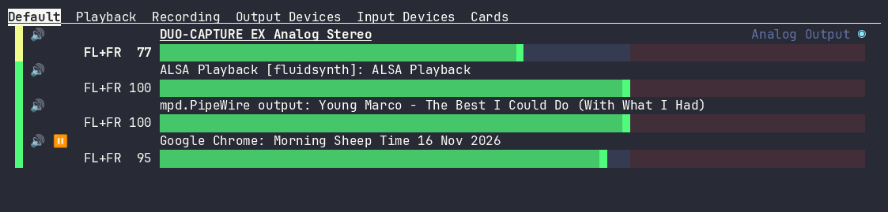

# pipmix

A terminal mixer for PipeWire, inspired by [pipemixer](https://github.com/heather7283/pipemixer) and [pavucontrol](https://freedesktop.org/software/pulseaudio/pavucontrol/).



## Install

Requires Go 1.27 or later:

```sh
go install github.com/some-programs/pipmix@latest
```

Make sure `$GOPATH/bin` (usually `~/go/bin`) is in your `$PATH`, then run:

```sh
pipmix
```

Press  ?  inside  pipmix  for context-sensitive key and mouse help.


## Features

- **Default overview tab**: Keeps your default output device and active playback streams together in one view, alongside dedicated tabs for Playback, Recording, Output Devices, Input Devices, and Cards (`1`–`6` or `Tab`).
- **Live level meters**: Smooth per-channel average and peak-hold meters directly inside the volume faders, automatically paused when the terminal loses focus.
- **MPRIS media integration**: Displays currently playing track titles on playback streams, with controls to play/pause (`p`) or solo a stream (`s`).
- **Full keyboard and mouse control**: Emacs and Vim-style keyboard navigation, per-channel volume unlocking (`Space`), port and card profile menus (`p`/`P`), default device switching (`D`), and click-and-drag faders.
- **Configurable**: Customizable via command-line flags, environment variables (`PIPMIX_*`), or `~/.config/pipmix/config.toml`.

## Configuration

`pipmix` reads `~/.config/pipmix/config.toml` (or `$XDG_CONFIG_HOME/pipmix/config.toml`, overridden with `-config`) if present. Each key in `[table]` corresponds to the `-table.key` flag and `PIPMIX_TABLE_KEY` environment variable (flags override environment variables, which override the config file).

Example `config.toml` showing the defaults:

```toml
[volume]
step = 5          # h/l step in percent
fine-step = 1     # H/L step in percent
max = 150         # maximum volume in percent (100 to 400)

[ui]
fps = 60          # max redraws per second (1 to 240)
tab = "default"   # starting tab: default, playback, recording, outputs, inputs, cards (or 1 to 6)

[meter]
enable = true
always = false    # keep metering when the terminal is unfocused
rate = 40         # peaks per second per meter (1 to 200)
mode = "both"     # both, average, or peak
look = "solid"    # solid, shade, or dot
speed = "normal"  # fastest, faster, normal, slower, or slowest
peak-hold = "1s"  # how long the peak indicator holds before falling

[mpris]
enable = true     # show track titles and media controls from D-Bus MPRIS players

[dedup]
enable = true     # hide mono playback streams that duplicate a multi-channel stream (helps to deal with chrome)

[mouse]
enable = true     # disable to allow normal terminal text selection

[jack]
enable = true     # list JACK clients
```

## Technical Details

- **Pure Go PipeWire protocol implementation**: Speaks PipeWire's native SPA POD protocol directly over the PipeWire Unix socket to track graph state and control volumes, mutes, routes, card profiles, and default devices, reconnecting automatically if PipeWire restarts.
- **On-demand metering via `pipewire-pulse`**: Level meters connect directly to the `pipewire-pulse` native socket with peak-detect streams only for the nodes currently visible on screen. When a node scrolls out of view, meters are toggled off (`a`), or the terminal loses focus, its meter streams are closed and the render loop goes quiet so that laptops can save on battery power.
- **MPRIS matching over D-Bus**: Watches `org.mpris.MediaPlayer2` players on the session bus and matches them to PipeWire streams by process ID (walking ancestor PIDs so multi-process browsers match their audio streams).
